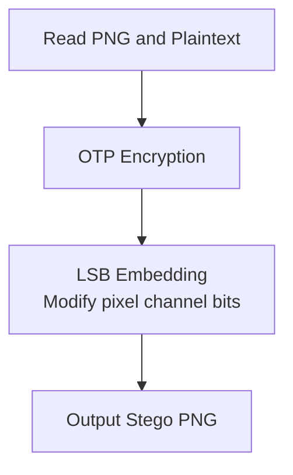
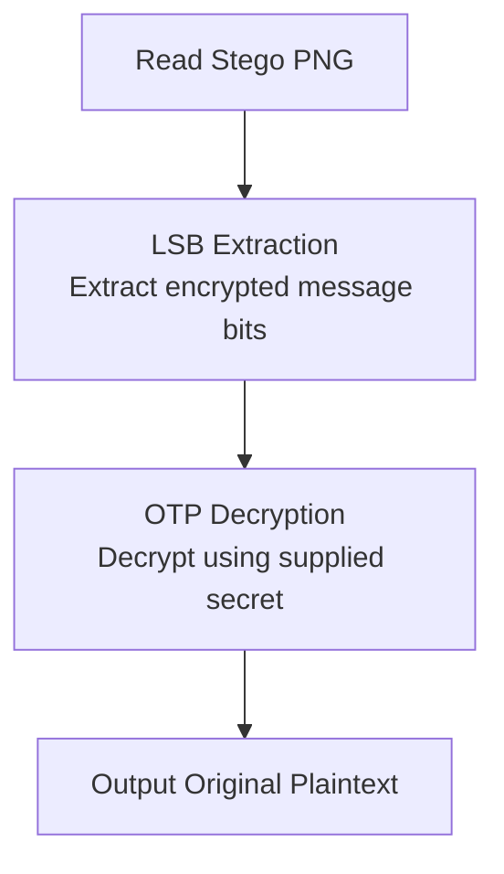
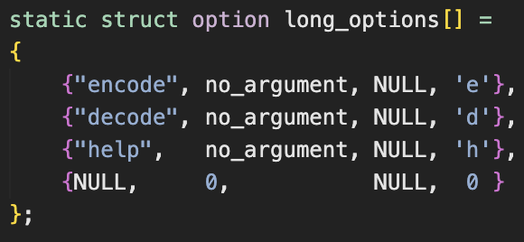
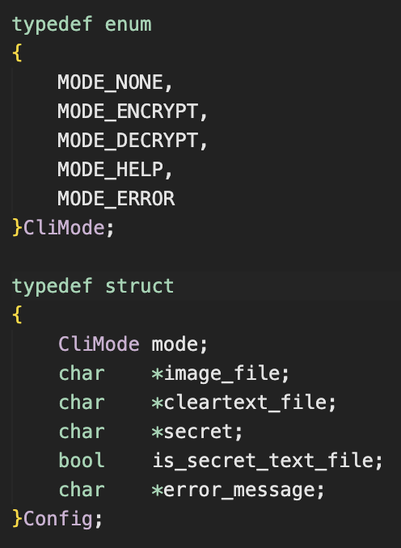

# Design

## Table of Contents

| Section |
|---------|
| [1. Project Overview](#1-project-overview) |
| [2. Application Architecture](#2-application-architecture) |
| [3. Data Structures](#3-data-structures) |
| [4. OTP](#4-otp) |
| [5. PNG Encoding](#5-png-encoding) |
| &nbsp;&nbsp;&nbsp;[5.1 Reading the PNG](#51-reading-the-png) |
| &nbsp;&nbsp;&nbsp;[5.2 Pixel Data and Memory](#52-pixel-data-and-memory) |
| &nbsp;&nbsp;&nbsp;[5.3 Image Capacity](#53-image-capacity) |
| &nbsp;&nbsp;&nbsp;[5.4 Message Length Header](#54-message-length-header) |
| &nbsp;&nbsp;&nbsp;[5.5 LSB Embedding](#55-lsb-embedding) |
| &nbsp;&nbsp;&nbsp;[5.6 Writing the Stego PNG](#56-writing-the-stego-png) |
| [6. PNG Decoding](#6-png-decoding) |
| &nbsp;&nbsp;&nbsp;[6.1 Reading the Stego PNG](#61-reading-the-stego-png) |
| &nbsp;&nbsp;&nbsp;[6.2 Extracting the Message Length](#62-extracting-the-message-length) |
| &nbsp;&nbsp;&nbsp;[6.3 Extracting the Ciphertext](#63-extracting-the-ciphertext) |
| [7. Design Decisions](#7-design-decisions) |
| [8. Error Handling](#8-error-handling) |
| [9. Limitations & Conclusion](#9-limitations--conclusion) |
| &nbsp;&nbsp;&nbsp;[9.1 Limitations](#91-limitations) |
| &nbsp;&nbsp;&nbsp;&nbsp;&nbsp;&nbsp;[16 Bit PNG Images](#16-bit-png-images) |
| &nbsp;&nbsp;&nbsp;&nbsp;&nbsp;&nbsp;[Grayscale PNG Images](#grayscale-png-images) |
| &nbsp;&nbsp;&nbsp;&nbsp;&nbsp;&nbsp;[Alpha Channel](#alpha-channel) |
| &nbsp;&nbsp;&nbsp;[9.2 Conclusion](#92-conclusion) |

## 1. Project Overview
This application is a command line PNG steganography tool developed in C.

It uses the Least Significant Bit (LSB) encoding to embed encrypted messages into PNG images. 

For the encryption, One-Time Pad is used to protect the message before embedding into the PNG file.

The application supports encoding and decoding operations through the command line arguments and uses libpng for PNG processing.

## 2. Application Architecture

| Module | Responsibilities |
|--------|------------------|
| `main.c` | Entry point of the application.|
| `main_functions.c / .h` | Coordinates encoding and decoding operations. |
| `cli.c / .h` | Handles command-line argument parsing, input validation, and usage instructions. |
| `file_reader.c / .h` | Handles reading input files and their contents. |
| `png_reader.c / .h` | Handles PNG image reading, pixel manipulation, and writing using libpng. | 
| `otp.c / .h` | Handles One-Time Pad encryption and decryption.|

## 3. Data Structures

| Structure | Purpose | Location |
|-----------|---------|----------|
| `Image` | Stores image dimensions, channels, and pixel data |[View png_reader.h](../src/png_reader.h)|
| `Config` | Stores the selected CLI mode and input arguments| [View cli.h](../src/cli.h)|
| `Mode` | Represents encode, decode, help, and error states | [View cli.h](../src/cli.h)|

## 4. OTP
For the project OTP, I am using XOR bitwise operator as it is reversible when we apply the key twice.

How it works
1. Read one byte from `clear_text`
2. Read the corresponding byte from the `key`
3. Perform a bitwise XOR operation
4. Store the encrypted byte in `cipher_text`

Example
| A (clear text) | B (key) | Q (cipher text) |
|----------------|---------|-----------------|
|0|0|0|
|0|1|1|
|1|0|1|
- XOR A and B will get you Q
- XOR B and Q will get you A

## 5. PNG Encoding

**The following code snippets are found in [png_reader.c](../src/png_reader.c) functions read_png() and alter_rgba_values()**



### 5.1 Reading the PNG

`read_png()` begins by opening the image and initializing the libpng structs.

```c
fp = open_png_file(filename);                    //manages the PNG reading process.
png_ptr = initialize_png_structs(fp, &info_ptr); //stores information about the PNG, including dimensions, bit depth, and color type.
```
Then we retrieve the image's metadata

```c
read_png_metadata(
    png_ptr,
    info_ptr,
    &image->width,
    &image->height,
    &image->bit_depth,
    &image->color_type
);

image->channels = png_get_channels(png_ptr, info_ptr);
```
Now we have the necessary information on how many pixels the picture has and how their color channels are organized

### 5.2 Pixel Data and Memory

Since we have the necessary information we now load the pixel data in memory so we can use / manipulate it

```c
image->rows = allocate_memory(
    png_ptr,
    info_ptr,
    image->height
);
```

### 5.3 Image Capacity

Checking for the max capacity the image can embed.

```c
uint64_t capacity =
    (uint64_t)image->width * image->height * 3;

image->max_message_length =
    capacity >= 32 ? capacity - 32 : 0;
```
The calculation is multiplying the number of pixels by 3 as I am only using RGB values of each pixel, storing one bit in each channel. The first 32 bits are reserved for the message-length header.

### 5.4 Message Length Header
Once we have the message length, I store it in the first 32 bits.

```c
if (counter < 32)
{
    bit = (cipher_text_binary_length >> (31 - counter)) & 1;
}
```

I also convert the ciphertext into bits

```c
uint32_t cipher_text_binary_length =
    (uint32_t)(length * 8);
```

### 5.5 LSB Embedding
Once the header is stored, I start embedding the ciphertext bits

```c
uint64_t message_index = counter - 32;

unsigned char byte = cipher_text[message_index / 8];

bit = (byte >> (7 - (message_index % 8))) & 1;
```

The calculation
1. counter - 32 skips the header positions.
2. message_index / 8 identifies which ciphertext byte contains the bit.
3. message_index % 8 identifies the bit position within that byte.
4. The right shift and & 1 extract that bit.

The actual pixel modification occurs here
```c
pixel[c] = (pixel[c] & 0xFE) | bit;
```

### 5.6 Writing the Stego PNG
After embedding the encrypted data, I then write a new PNG file using the information.

```c
png_set_IHDR(
    png,
    info,
    image->width,
    image->height,
    8,
    PNG_COLOR_TYPE_RGBA,
    PNG_INTERLACE_NONE,
    PNG_COMPRESSION_TYPE_DEFAULT,
    PNG_FILTER_TYPE_DEFAULT
);
```
This is the configuration of the output PNG we will be creating where the following methods are used for actual png write operations.

```c
png_write_info(png, info);              //writes the PNG header and associated information
png_write_image(png, image->rows);      //writes the modified pixel data
png_write_end(png, NULL);               //completes the PNG file.
```

## 6. PNG Decoding
**The following code snippets are found in [png_reader.c](../src/png_reader.c) functions read_png(), get_message_length(), extract_cipher_text()**



### 6.1 Reading the Stego PNG
I use the same read_png() function as we did in encoding step to load the stego png information into memory.

### 6.2 Extracting the Message Length
Then I call the get_message_length to calculate the length of the encrypted message.

```c
int bit = pixel[c] & 1;

length = (length << 1) | bit;

counter++;

if (counter == 32)
    return length;
```
It works by
1. pixel[c] & 1 extracts the channel's least significant bit.
2. length << 1 shifts the previously extracted bits one position left.
3. | bit appends the newly extracted bit.
4. After 32 bits, the function returns the encrypted message length in bits.
This is the reverse of the header-embedding process.

### 6.3 Extracting the Ciphertext
Once I get the message length, `extract_cipher_text()` validates it 

```c
uint64_t capacity =
    (uint64_t)image->width * image->height * 3;

if (capacity < 32 ||
    length > (capacity - 32) / 8)
{
    fprintf(stderr, "ERROR: Invalid ciphertext length\n");
    return 1;
}
```
Once validated, I skip the first 32 bits of the image

```c
if (counter < 32)
{
    counter++;
    continue;
}
```
then start extracting the encrypted message

```c
int bit = pixel[c] & 1;

size_t byte_index = bit_index / 8;

cipher_text[byte_index] =
    (unsigned char)((cipher_text[byte_index] << 1) | bit);

bit_index++;
counter++;
```

Each extracted bit is then appended to one another to create the ciphertext which will be decoded using the OTP decryption.

## 7. Design Decisions

| Decision | Reason |
|----------|--------|
| Message Length Header | Reserved the initial LSB positions to store the encrypted message's length. This allows the decoder to determine exactly how many bits to extract without requiring a delimiter or prior knowledge of the message size. |
| Excluding Alpha Channel (RGBA) | Only the RGB channels are modified during LSB embedding. The alpha channel is preserved because even a small change from 0 to 1 can significantly affect transparency, particularly for fully transparent pixels. |


## 8. Error Handling
Most of the application's input validation and error handling is performed during the [cli](../src/cli.c) phase, before the encoding or decoding process begins. This ensures that the user has provided the required arguments and that the necessary input files are accessible before execution.

The long_options array defines the supported operations and allows users to provide either short or long versions of each option.



Each entry in long_options maps a long option to a corresponding character. For example, `--encode` maps to `'e'`, allowing `getopt_long()` to handle both `-e` and `--encode` using the same switch case.

Once an operation is identified, the application validates the supplied arguments before preparing for execution.

| Validation | Purpose |
|------------|---------|
| Argument Count | Ensures the correct number of arguments is supplied for encoding or decoding |
| File Existence | Uses `fopen()` to verify that required input files can be opened |
| PNG Extension | Checks that the image filename ends with `.png` |
| Secret Type | Determines whether the supplied secret is a direct string or a `.txt` file |
| Invalid Options | Handles unrecognized command-line options |
| Missing Arguments | Displays usage instructions when no arguments are provided |

When validation fails, the application sets the configuration mode to `MODE_ERROR` and stores an appropriate error message. This prevents the application from proceeding with an invalid configuration when the execution logic checks the mode.

After the arguments have been validated, the application prepares a `Config` structure containing the information required for execution.



| Field | Purpose |
|-------|---------|
| `mode` | Determines whether the application should encode, decode, display help, or report an error |
| `image_file` | Stores the path to the input PNG |
| `cleartext_file` | Stores the path to the plaintext file for encoding |
| `secret` | Stores the supplied encryption/decryption secret or file path |
| `is_secret_text_file` | Indicates whether the secret is provided through a text file |
| `error_message` | Stores an error message when validation fails |

The `Config` structure acts as a **preprocessing blueprint for program execution**. Rather than having the encoding and decoding functions interpret command-line arguments independently, the CLI prepares a configuration describing which operation to perform and which inputs to use.

This separation allows the main execution logic to focus on processing the data rather than parsing user input.

## 9. Limitations & Conclusion

### 9.1 Limitations

#### 16 Bit PNG images
The current implementation is designed around 8-bit color channels, where each RGB channel occupies one byte (0–255).

In 16-bit PNG images, each channel occupies two bytes (0–65535). Since the current LSB encoding logic assumes one byte per channel, it cannot correctly process 16-bit channel values without additional handling.

Supporting 16-bit images would require adjusting the pixel-reading and bit-manipulation logic to account for two-byte channel values or converting the image to 8-bit channels before encoding.

#### Grayscale PNG Images

The current implementation primarily supports RGB and RGBA images, where each pixel contains separate red, green, and blue channels.

Grayscale images contain a single intensity channel, or an intensity and alpha channel. Because the encoding process is designed around RGB channels, it cannot directly process grayscale images using the same channel indexing logic.

Supporting grayscale images would require implementing channel-specific embedding logic or converting grayscale images into RGB before processing.

#### Alpha Channel

The application intentionally avoids modifying the alpha channel in RGBA images to preserve transparency. This reduces the available embedding capacity but prevents unintended changes to transparency values.

### 9.2 Conclusion

Through this assignment, I have gained a better understanding of these topics
- LSB Steganography: Embedding and extracting encrypted messages by modifying the LSB of RGB values
- OTP Encryption: Encrypting cleartext before embedding
- Message Length Header: Reserving initial bits to indicate the length of the encrypted message
- Command Line Interface: Supporting encoding and decoding and input validation through command line arguments
- PNG processing: Using libpng to read and write PNGs

I learned that even seemingly insignificant parts of a file, such as the least significant bits of pixel values, can be used to hide information without noticeable changes. This made me realize that areas of a system that appear unused or unimportant can still be exploited for malicious purposes