# Testing

## Table of Contents
| Test | Expected Result | Actual Result | Evidence |
|------|-----------------|---------------|----------|
| No inputs | Print usage of Application | PASS| [View Test](#no-inputs--back-to-top) |
| Wrong Mode | Print an error message | PASS | [View Test](#wrong-mode--back-to-top) |
| Wrong File Location | Print an error message | PASS | [View Test](#wrong-file-location--back-to-top) |
| Wrong Image Type | Print an error message | PASS | [View Test](#wrong-image-type--back-to-top) |
| Empty Text File | Print an error message | PASS | [View Test](#empty-text-file--back-to-top)|
| Word to be encoded is larger than allocated space in PNG | Print an error message | PASS | [View Test](#word-to-be-encoded-is-larger-than-allocated-space-in-png--back-to-top) |
| Key and Clear Text are not the same size | Print an error message | PASS | [View Test](#key-and-clear-text-are-not-the-same-size--back-to-top)|
| Encode RGBA PNG | Produces output.png with encoded message. Prints out encoded value. Image is indistinguishable. | PASS | [View Test](#encode-rgba-png--back-to-top)|
| Decode RGBA PNG | Prints out the encoded message in the output.png | PASS | [View Test](#decode-rgba-png--back-to-top)|
| Encode RGB PNG (all white) | Produces output.png with encoded message. Prints out encoded value. Image is indistinguishable. | PASS | [View Test](#encode-rgb-png-all-white--back-to-top)|
| Decode RGB PNG (all white) | Prints out the encoded message in the output.png | PASS | [View Test](#decode-rgb-png-all-white--back-to-top)|
| Encode RGB PNG (all black) | Produces output.png with encoded message. Prints out encoded value. Image is indistinguishable. | PASS | [View Test](#encode-rgb-png-all-black--back-to-top)|
| Decode RGB PNG (all black) | Prints out the encoded message in the output.png | PASS | [View Test](#decode-rgb-png-all-black--back-to-top)|
| Encode 16 bit PNG | Produces output.png with encoded message. Prints out encoded value. Image is indistinguishable. | FAIL |[View Test](#encode-16-bit-png--back-to-top)|
| Encode / Decode GrayScale PNG | Produces output.png with encoded message. Prints out encoded value. Image is indistinguishable. | FAIL | [View Test](#encode--decode-grayscale-png--back-to-top)|

## No inputs | [Back To Top](#table-of-contents)
### Command to replicate
`./app`

## Wrong mode | [Back To Top](#table-of-contents)
### Command to replicate
`./app`

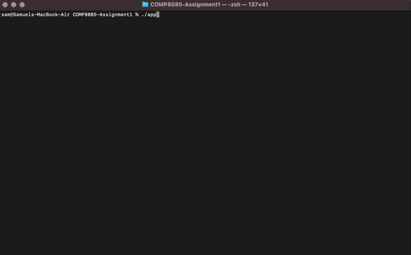

## Wrong File Location | [Back To Top](#table-of-contents)
### Command to replicate
`./app -e ./docs/wronglocation.txt ./docs/wronglocation.txt secret`

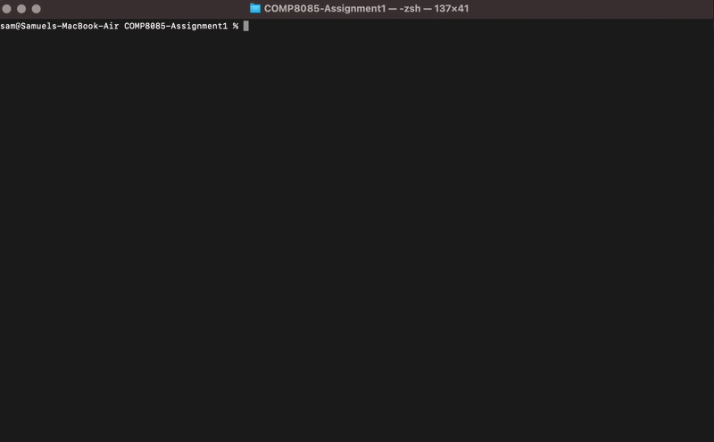

## Wrong Image Type | [Back To Top](#table-of-contents)
### Command to replicate
`./app -e ./docs/wrongphoto.avif ./docs/message.txt ./docs/secret.txt`

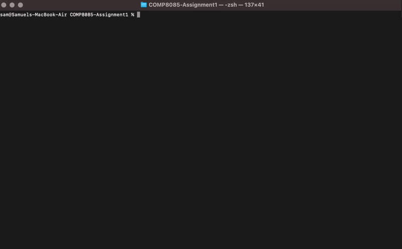

## Empty Text File | [Back To Top](#table-of-contents)
### Command to replicate
`./app -e ./docs/image.png ./docs/emptymessage.txt ./docs/secret.txt`

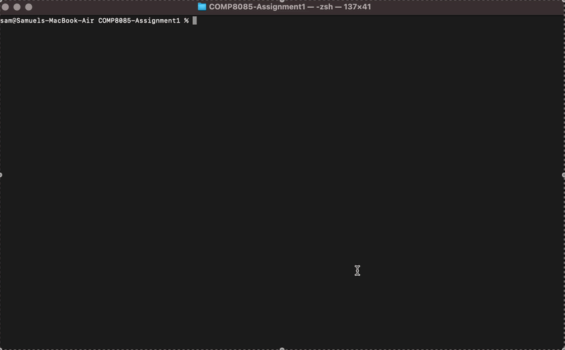

## Word to be encoded is larger than allocated space in PNG | [Back To Top](#table-of-contents)
### Command to replicate
`./app -e ./docs/image.png ./docs/largemessage.txt ./docs/secret.txt`

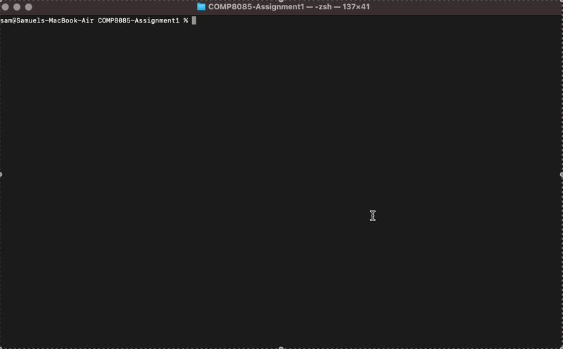

## Key and Clear Text are not the same size | [Back To Top](#table-of-contents)
### Command to replicate
`./app -e ./docs/image.png ./docs/cleartextnotsamesize.txt ./docs/secretnotsamesize.txt`

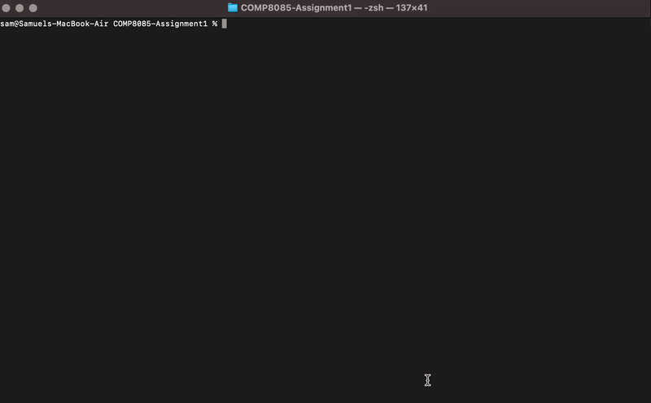

## Encode RGBA PNG | [Back To Top](#table-of-contents)
### Command to replicate
`./app -e ./docs/image.png ./docs/message.txt ./docs/secret.txt`

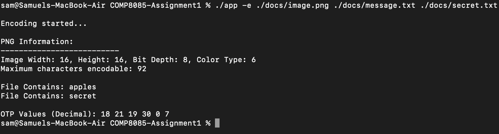

## Decode RGBA PNG | [Back To Top](#table-of-contents)
### Command to replicate
`./app -d ./docs/output.png ./docs/secret.txt`

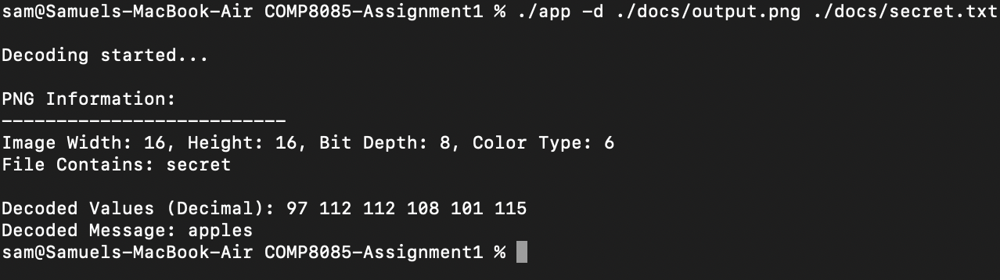

## Encode RGB PNG (all white) | [Back To Top](#table-of-contents)
### Command to replicate
`./app -e ./docs/white.png ./docs/message.txt ./docs/secret.txt`

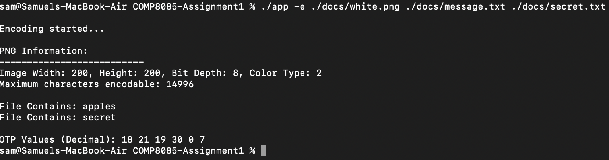

## Decode RGB PNG (all white) | [Back To Top](#table-of-contents)
### Command to replicate
`./app -d ./docs/output.png ./docs/secret.txt`

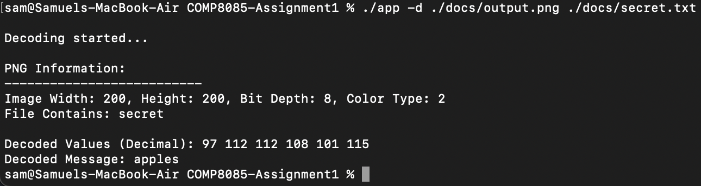

## Encode RGB PNG (all black) | [Back To Top](#table-of-contents)
### Command to replicate
`./app -e ./docs/black.png ./docs/message.txt ./docs/secret.txt`

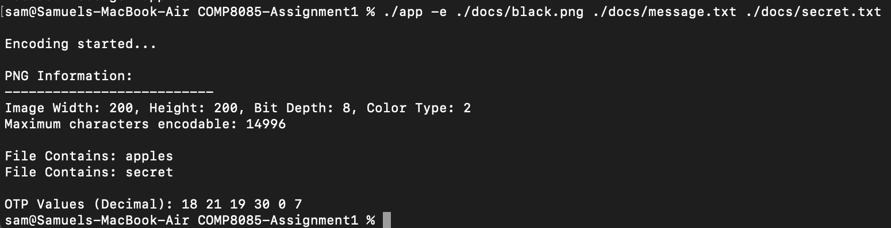

## Decode RGB PNG (all black) | [Back To Top](#table-of-contents)
### Command to replicate
`./app -d ./docs/output.png ./docs/secret.txt`

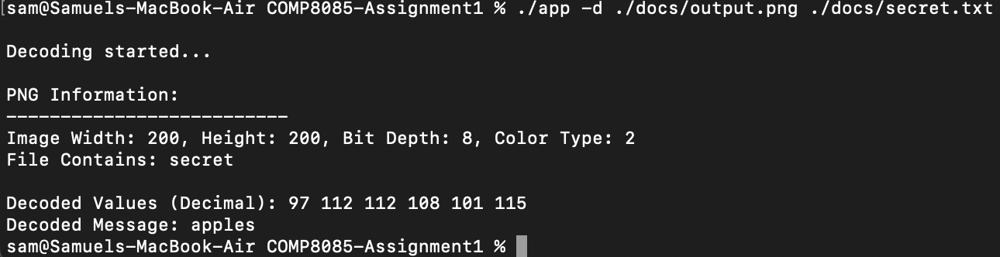

## Encode 16 bit PNG | [Back To Top](#table-of-contents)
### Command to replicate
`./app -e ./docs/white.png ./docs/message.txt ./docs/secret.txt`

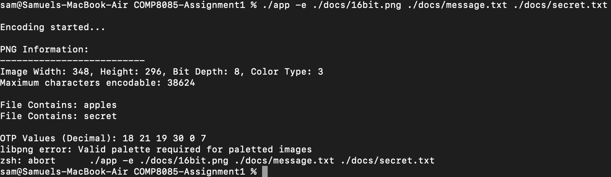

## Encode / Decode GrayScale PNG | [Back To Top](#table-of-contents)
`./app -e ./docs/grayscale.png ./docs/message.txt ./docs/secret.txt`
- It appears to be successful

`./app -d ./docs/output.png ./docs/secret.txt`
- However we can see that when we decode we run into an error.
- This means that the encoding is also NOT successful.

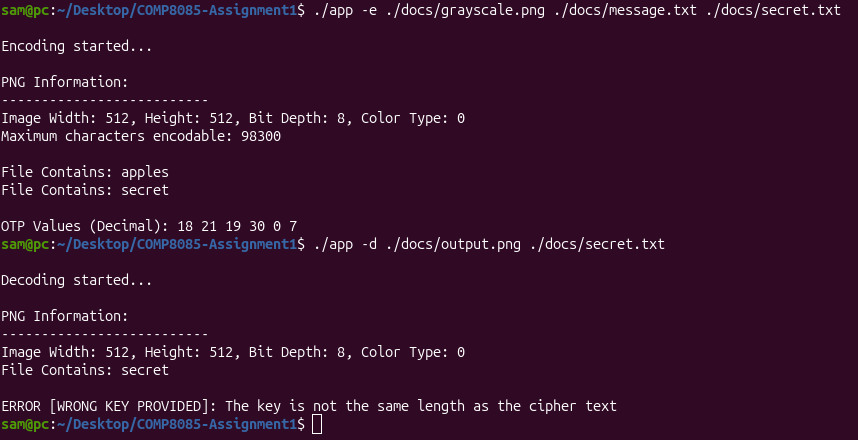